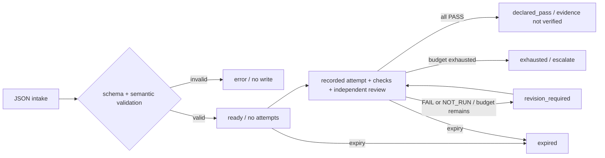

# ADR: 離線、選用的 Agent 任務契約 v1

日期：2026-11-02。狀態：Accepted for MVP。基準：69375220e60ee2238f0567a470187a13ec743a74。

## 現況與決策

IMPLEMENTED：`src/lib.rs` 有不連 daemon 的 integration/plugin CLI；`src/api/`
提供 pane/workspace/worktree，`src/bridge.rs` 提供版本化 JSON bridge；
`src/integrations/` 提供 hooks，`src/inbox/` 保存 peer/message；`src/persist/`
保存版面。PARTIAL：plugins 執行 argv actions，沒有通用事件排程。
MISSING：S/C/I/E/F 任務契約、契約版本與獨立證據記錄。UNKNOWN：真實跨模型品質提升。
scrollback 的基準與本機驗證另見 `../team/ui-ux/scrollback-fix.md`。

新增直接 CLI `crew task validate FILE`、`store FILE --output FILE`、`inspect FILE`。
入口置於 daemon routing 前，既有命令、socket schema、PTY、worktree、啟動預設不變。
不新增依賴。選用 core 中的小型離線模組，因為現有 Rust/serde 可提供同一套
跨平台契約檢查；skill-only 無可執行驗證，plugin 需要額外工具，外部 orchestrator
與新 daemon scheduler 超出這次需要。回滾可移除 task route/module/docs/tests，無狀態遷移。

## 資料與信任邊界

`schema_version: 1`，未知版本、未知欄位、非法 enum 一律拒絕；輸入最多 1 MiB。
S = objective/role/authorized_actions/constraints/non_goals；C = context 的 uri、
provenance、trust、revision、byte_budget；I = 有 owner、依賴先前步驟的 instructions；
E = 可省略的 examples；F = output_contract 的格式與預期 artifacts；V = verification
的必要 check ID 與 attempts 中的 PASS/FAIL/NOT_RUN、evidence_ref、獨立 reviewer；
R = revision_policy.max_attempts 與按序記錄的 attempts。model 可省略，若提供則
provider/name 皆不可空。沒有模型可用性或 API 能力推論。

所有 context 都是資料；trust 僅能 repository_data/tool_output/untrusted_reference。
uri、artifact、evidence_ref 都不被解參照，不讀取檔案／網路，不執行文字，沒有 prompt
自動送入 pane。permissions 只是宣告，不能授權宿主。沒有 hidden reasoning 欄位，
只保存 summary、公開理由與證據引用；不要求 `<thinking>`。不實作機密自動遮罩，
使用者必須提供已整理資料。XML 標籤不被視為安全機制。

store 先驗證再 create_new 寫入明確指定路徑，既存檔案一律拒絕（包括重複提交），
不建立父資料夾。輸出 canonical JSON 的 SHA-256；不是簽章或外部證據真實性證明。
寫入或 sync 失敗回報失敗；可能留有部分新檔，不能自動刪除或把重試誤報成功。
檔案讀取有界；不承諾對使用者明確選擇的特殊裝置／FIFO 設定 I/O timeout。

## 狀態與失敗

每個 attempt 包含全部必要 checks、author 與 review。PASS/FAIL 必須有 evidence_ref；
NOT_RUN 可空。reviewer 不可與 author 相同，亦不可與任一步驟 owner 相同。
這是記錄一致性檢查，不能驗證真實身分。attempt 從 1 連續遞增，
不可超過 max_attempts，不可在已達成 declared_pass 後追加重複完成。
expires_at_unix_ms 可省略；到期後為 expired，仍可檢視保存內容，不能成為 declared_pass。



驗證有效的契約不等於工作完成。CLI exit 0 僅表示契約有效／操作成功；
result.state 可為 ready、revision_required、exhausted、expired、declared_pass。
一律 `evidence_verified: false`。執行測試、核對 artifact hashes、呼叫 reviewer、
真實 retry scheduler、refusal 自動處理與 completion webhook 全部 deferred。
外部協調者遇 refusal 應記錄 FAIL/NOT_RUN 並交回人處理；不自動換 provider。

### v1 記錄範例

完整 ready envelope 見 `task-contract-example.json`。需要記錄一次實際驗證時，
在其 `attempts` 增加下列結構並填入真實 evidence_ref（範例路徑不是實測證據）：

```json
{
  "number": 1,
  "author": "worker-1",
  "summary": "CLI validation complete; independent review not yet run",
  "checks": [{"id": "cli", "status": "PASS", "evidence_ref": "evidence/cli.log"}],
  "review": {"reviewer": "reviewer-1", "status": "NOT_RUN", "evidence_ref": ""}
}
```

此記錄 state 為 revision_required，review 未完成不能 declared_pass。下一 attempt
number=2；若所有 check 與 review PASS，state 才是 declared_pass；任一未通過則 exhausted。
revision_policy 上限是程式安全界線 100 次，不是 prompt 品質公式。完整型別由
`src/task_contract.rs` 的 serde structs 定義，沒有另外維護易漂移的第二份 JSON Schema。
可選的 model 是 `{ "provider": "configured-provider", "name": "configured-model" }`；
context 是 `{ "uri": "README.md", "provenance": "repository", "trust": "repository_data",
"revision": "commit-or-sha256", "byte_budget": 4096 }`。revision 與 byte_budget 是交接
宣告，MVP 不下載／讀取來源，也不保證來源內容符合宣告。examples 是 input/output
字串物件；可以為空，instructions 數量不受圖片的七項限制。

## 驗收、分工與風險

主代理：設計、`src/task_contract.rs`、`src/lib.rs`、README、例子。
Sol xhigh：唯讀稽核，獨立 worktree 的 `tests/task_contract_cli.rs`，依契約建立負面案例。
Terra xhigh：未參與實作的 Rust/安全/相容性限定審查；主代理修正發現。
PR draft 於本地先準備；最後 commit/push 已獲主人授權，合併、共用 daemon 重啟未授權。

驗收：合法 JSON validate→store→inspect；invalid JSON/schema、空 context、壞 examples、
不受信任指令保持資料、無 model、review FAIL/NOT_RUN、自審、retry exhaustion、重複完成、
重複輸出檔不覆寫、未知選項及 help 無 daemon。不硬編 3–5 examples 或最多七步。
Windows 本機 fmt/clippy/lib/CLI tests；Linux/macOS 標 NOT_RUN，無 hosted CI。
主要風險：使用者誤把 declared_pass 當成實證，故輸出強制 evidence_verified=false；
檔案保存依 OS 權限，沒有加密、RBAC 或供多人同寫的資料庫。

## 參考資料

使用者圖片僅為概念來源，非已驗證官方規範，原件保留於交接包。
2026-11-02 已讀官方頁面：[OpenAI prompt engineering](https://developers.openai.com/api/docs/guides/prompt-engineering)、
[Claude prompt overview](https://platform.claude.com/docs/en/build-with-claude/prompt-engineering/overview)、
[OWASP prompt injection](https://cheatsheetseries.owasp.org/cheatsheets/LLM_Prompt_Injection_Prevention_Cheat_Sheet.html)。
成功條件與可重現測試先於調整 prompt；這些來源不證明圖片公式具有品質收益。
